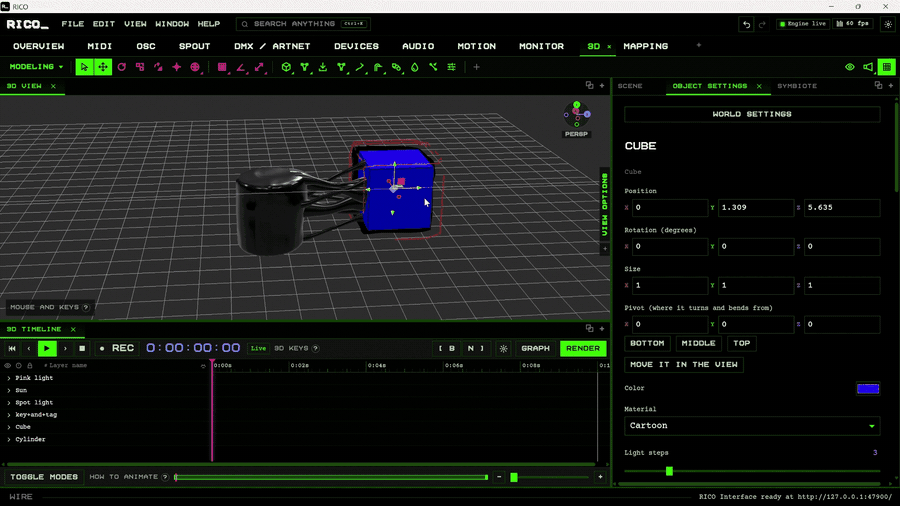
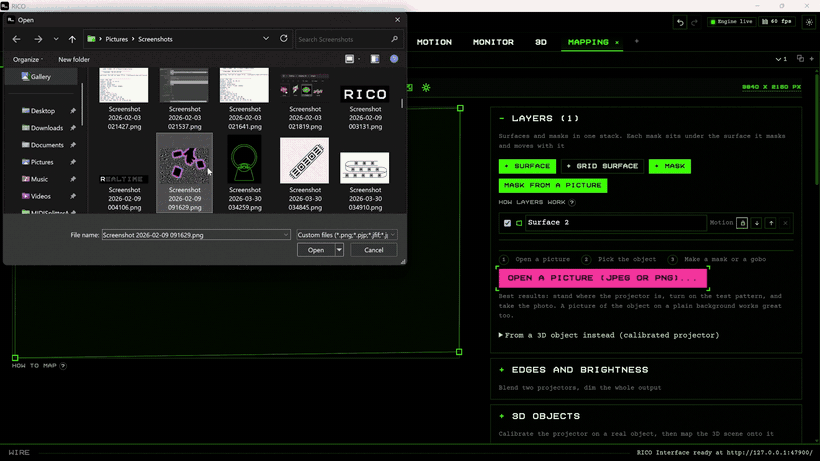
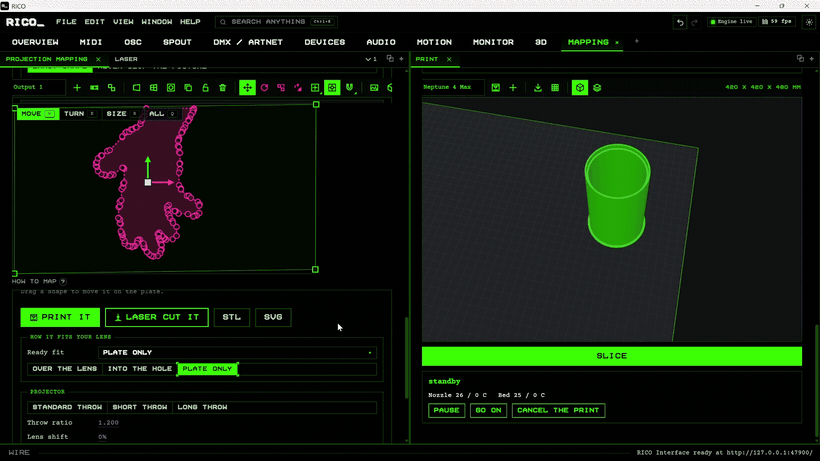
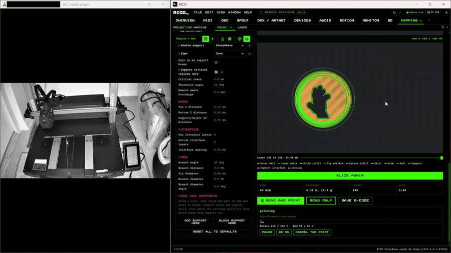
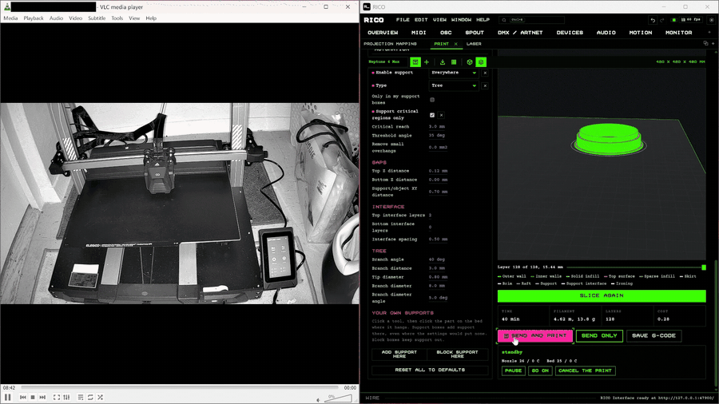

# RICO Engine

**Real-time Integration Control Operations.** RICO is a free creative
engine and signal hub for Windows. Make a whole piece inside it, or let it
sit between your controllers, your creative apps and your hardware and make
them talk to each other.



**[Watch the RICO Engine preview on YouTube](https://www.youtube.com/watch?v=nZg4tgeFwy8)**

Turn a knob on a MIDI controller and move a light in Unreal, a camera in
Blender or a parameter in Houdini. Send the visuals you make in RICO to
TouchDesigner or to another computer on your network. Plug in a homemade
controller and use it everywhere.

## An engine and a bridge

RICO started as a bridge and is now a full engine. You can use it either
way, or both at once:

- **On its own.** Make the whole piece inside RICO: motion graphics on a
  timeline, 3D scenes with living simulations, sound, lights, projection
  mapping and LED walls, all running live and rendered from one place. You
  do not need any other app.
- **As a bridge.** Keep the apps you already use, and let RICO connect
  them. A knob, a phone, a microphone or a sensor drives Unreal, Blender,
  TouchDesigner, lights and hardware at the same time.
- **Both.** Build part of the work in RICO and send it on, or bring signals
  and video in from other apps and use them in RICO's own scenes.

I made RICO because every app speaks a different language, and I was tired of
needing five small tools to connect them. RICO is meant to be your right hand
for all of these protocols, whether you are a VJ, a 3D artist, a designer or
someone building their own hardware.

## A look inside

**From a photo to a mask.** Open a picture, click the object, and RICO cuts it out as a projection mask.



**From the mask to a gobo.** The mask becomes a gobo plate with a sleeve that slides snugly over the projector lens.



**Sliced and printed, without leaving RICO.** Supports, settings and Send and print, straight to the printer.

| | |
|---|---|
|  |  |

## What it speaks

| | In | Out |
| --- | --- | --- |
| MIDI | Any controller or app | Devices, apps and virtual ports |
| OSC | Phones, tablets, apps | Many apps at once |
| Video | Spout, OMT, NDI (plugin), screen capture | Spout, OMT, NDI (plugin) |
| Audio | What your computer plays | Low, mid, high and beat signals |
| Lights | | DMX over Art-Net |
| Devices | MQTT (ESP32, Raspberry Pi) | MQTT |

## What's inside

- **A new interface.** Clean, fast and made for creative people, not only
  programmers. The original interface is still there as "classic".
- **Workspaces you build.** Tabs on top for each protocol. Split, stack and
  float panels, put MIDI, OSC and audio side by side, close what you don't
  use, and share a workspace with someone as a `.ricospace` file.
- **Routes.** One knob, OSC address or sound to many places at once: OSC,
  MIDI, DMX and MQTT, each with its own range.
- **Nodes.** Numbers, pictures (on the graphics card), 3D shapes, text and
  lists on typed wires, in sections from what comes in to what goes out. Write your own nodes, save them to My nodes, or put a
  network in a container. Save networks as `.ricox` files.
- **Motion.** Laid out like a compositing app: a green tool strip with your own tools, the project, the composition, effect controls, effects and presets, and the timeline. Layers of chroma glass, blobs, noise, grids, shapes, text,
  pictures and a camera, any setting linked to a knob, OSC or the kick drum. Precomps, ripple delete and close gap. A timeline that zooms from the whole comp to single frames, with solids, nulls, shape layers, text,
  adjustment layers, transforms and parenting, masks, track mattes, 34
  effects, 16 blend modes, the usual motion graphics keys, rulers, guides and safe
  areas, rotoscoping (keyed mask paths, and a live clean-plate background
  remover), your own GLSL layers that react live, curves that send OSC,
  MIDI and DMX, cues, and real time or frame-exact MP4 rendering. The
  timeline zooms with a navigator bar, shows time as frames, seconds or
  timecode, folds keys into dots, and has comp settings (size, frame rate,
  snap, loop) one click away. Precomps play with their own time and show
  the layers under them through.
- **Color.** Grading, curves, levels, .cube LUTs, and a LUT matched from a
  single picture.
- **Audio lab.** Accurate bands you shape and name yourself, tempo, pitch,
  LUFS, input EQ, gate and compressor, and speech, music and effects
  detection, on its own thread.
- **Sound editor.** A multitrack session with live effects per track,
  instrument tracks you play from the keyboard or MIDI, recording, a piano
  roll and mixdown; plus a waveform editor and a sound generator.
- **Projection mapping.** Surfaces, grids, masks (also from a photo with a
  magic wand, or from a 3D object) that sit under the surface they mask and
  move with it, a canvas in the exact size you set, soft edges, 3D objects from a
  calibrated projector, and lens gobos: one per projector, the exact shape
  of your masks, on a round plate that slides snugly over the lens or into
  the lens hole.
- **Print and laser.** A slicer that sends gobos and STL files to
  Klipper, OctoPrint and PrusaLink printers or over USB, with the full set
  of print settings, normal and tree supports (and your own) found from the
  faces of the part, support walls that stand firm, profiles you can import, and automation for robots that work with the printer. Laser
  cutting for GRBL and FluidNC lasers.
- **Lighting desk.** Fixtures, groups, color and position, effects in time
  with the music, cues with fades, links to any signal, 3D twins with beams
  and heads that aim at 3D objects, Art-Net and sACN on
  many universes.
- **LEDs and your own hardware.** Send the picture to LED strips and walls
  (WLED, Art-Net, sACN, Adalight, Open Pixel Control) and values to a
  Raspberry Pi, Arduino, ESP32, MQTT, web addresses or WebSockets, with
  starter code for each.
- **Phone and tablet controls.** Build pages with faders, knobs, pads, a
  step sequencer, tap tempo and tilt, design them with titles, text, logos
  and pictures, scan a QR code, and send OSC (to any app or device), MIDI,
  DMX, MQTT, UDP or web addresses, or move anything in RICO, from your
  phone or tablet.
- **MIDI rules.** Translate any MIDI to MIDI, OSC, DMX or signals, one to
  many; monitor with filters; MIDI clock out.
- **3D playground.** Model, sculpt and paint (with pen pressure), your own
  layered materials, iridescent film colors, cartoon shading with
  hand-drawn outlines, bloom, shapes from math and code, your own shaders,
  Motion as a texture, `.glb`, `.fbx` and `.obj` import with animations
  and every part on its own, strokes made of lines, dots or letters, pop
  art, pencil, watercolor, paper collage and moving chrome looks added on
  top of a model's own materials, 3D text in your own fonts, comic pages,
  deep world settings, and an export that bakes the look so it opens the
  same in other 3D apps. Mixed media paper that really crumples and lifts
  off the shape. A tool strip with stages for modeling, texturing,
  lighting, animating and rendering, an axis ball, World or Object
  handles, a 3D timeline, deformers (bend, twist, taper, squash, wave),
  morphing, bone posing, and light simulation: gravity, bumping, breaking
  and a small fluid. A movable pivot, so shapes turn, size and bend from
  the point you choose. All linkable to signals and usable as a Motion
  layer or a precomp with its own time.
- **Symbiote.** Turn any shape or model into a living alien goo. Its skin
  crawls, swells and breathes, with veins under the skin that push it out
  and throb. Tendrils shoot out toward things near it, a few thick and many
  thin, grab on, sag and stretch into a web when you pull away, then snap
  one by one, curl back and drip onto the floor, where the puddles stay or
  fade. Two symbiotes reach for each other and can be ripped apart. Every
  part of how it looks and moves is in its own Symbiote tab, and every
  number can be keyed or linked to a signal.
- **Fluid morph.** A shape melts into another like a living goo, and the
  outline follows the moving surface.
- **Nodes as text.** Any node network can be written as a few readable
  lines and read back, so you can write networks by hand or with a code
  helper.
- **A welcome page and a tour.** What RICO does, what people make with it,
  and a two-minute tour of every part. Hover any button for what it does,
  its shortcut and a link to read more.
- **Interface size.** Fit your screen, or pick your own size, in
  File > Settings.
- **Output windows.** Send Motion to a projector and pin its corners onto a
  surface. Soft edges for two projectors.
- **Other screens.** Open RICO on a tablet or a second computer and share
  changes live. Save everything as one `.ricoproject`, or start from a
  starter project.
- **Scripts for any protocol.** A script panel can open UDP, TCP and serial
  ports, send OSC anywhere and make its own controls. It travels inside the
  workspace file. See [docs/SCRIPTS.md](docs/SCRIPTS.md).
- **Your colors, your shortcuts.** Six color themes or your own five colors.
  Any command can run from a key, a MIDI pad, an OSC button or the kick drum.
- **Open Media Transport (OMT).** Open source network video, built in.
- **NDI as a plugin.** If you have NDI Tools installed, drop in the plugin and
  RICO uses it. If not, RICO runs exactly the same without it.
- **Virtual MIDI ports with Windows MIDI Services.** No extra drivers.
- **Setups for 3D apps.** Step by step for Blender, Unreal Engine, Maya,
  Houdini, TouchDesigner and Unity, with small scripts for the apps that don't
  speak OSC by themselves (see `integrations/`).
- **Portable.** Settings live in a `data` folder next to RICO.exe, so RICO
  runs from a USB stick. Nothing needs the internet.

## Download

Get the latest version from
[Releases](https://github.com/mayakhalil-cmd/RICO-Engine/releases). Unzip it anywhere,
also on a USB stick, and open `RICO.exe`.

RICO needs Windows 10 or 11. Some parts need a little more:

- **New interface:** Microsoft Edge WebView2. Windows 11 has it already.
- **Virtual MIDI ports:** Windows 11 with
  [Windows MIDI Services](https://aka.ms/midi).
- **NDI:** [NDI Tools](https://ndi.video/tools/) installed, and
  `rico-ndi.dll` in the `plugins` folder.

When something is missing, RICO tells you what and keeps working with the
rest.

## Build it yourself

You need Visual Studio 2022 with "Desktop development with C++", CMake,
[vcpkg](https://github.com/microsoft/vcpkg) and Node.js.

```powershell
git clone https://github.com/mayakhalil-cmd/RICO-Engine.git
cd RICO-Engine
cmake --preset windows
cmake --build --preset release
```

RICO ends up in `build\RICO\`, ready to copy anywhere. The Teletactile
title font is not in the repository; put `Teletactile.ttf` in
`ui/public/fonts/` before you build, or RICO uses Courier Prime for titles. The full guide, with
the problems people usually run into, is in [docs/BUILDING.md](docs/BUILDING.md).

## Folder guide

| Folder | What is inside |
| --- | --- |
| `app/` | The engine: MIDI, OSC, video, audio, DMX, MQTT, and the classic interface |
| `ui/` | The new interface (TypeScript and WebGL) |
| `include/rico/` | The plugin API, plain C |
| `plugins/ndi/` | The NDI plugin |
| `integrations/` | Small scripts for Blender, Maya and Houdini |
| `third_party/` | The open source code RICO is built on |
| `docs/` | Building, testing, plugins and ideas for showcases |
| `tools/` | Icon maker and other helpers |

## Learn the interface

[docs/WORKSPACES.md](docs/WORKSPACES.md) is a tour of workspaces, routes,
nodes, the timeline, 3D, output windows and projects.

## Write a script

A protocol RICO does not speak yet is a few lines of JavaScript away. Read
[docs/SCRIPTS.md](docs/SCRIPTS.md).

## Make a plugin

Video transports are plugins: a DLL with two C functions. NDI is built this
way, and you can add others. Read [docs/PLUGINS.md](docs/PLUGINS.md).

## License

RICO Engine is free and open source under the
[GNU Affero General Public License, version 3 or later](LICENSE) (AGPL-3.0).
This covers every version of RICO Engine, including earlier releases and the beta.

- Use it for anything, including paid performances, installations, shows and
  client work. What you make with RICO is yours; the license does not cover it.
- If you share RICO, or a changed copy of it, you share its full source code
  under the same license.
- If you run a changed copy for other people over a network (as a web app, a
  hosted service or a remote control page), you offer them its source code too.
- Tools and patches that only talk to RICO over OSC, MIDI, DMX, MQTT, Spout or
  network video are separate works and can use any license.

[LICENSE-EXCEPTIONS.md](LICENSE-EXCEPTIONS.md) adds one permission: the
optional NDI plugin may load the NDI runtime, which has its own license.
The name RICO and the RICO logo are not covered by the license; see
[LICENSE-EXCEPTIONS.md](LICENSE-EXCEPTIONS.md).

The projects RICO is built on keep their own licenses, listed in
[THIRD_PARTY_NOTICES.md](THIRD_PARTY_NOTICES.md).

NDI(R) is a registered trademark of Vizrt NDI AB. RICO is not affiliated with
Vizrt or NDI.

Made by Maya Khalil.
